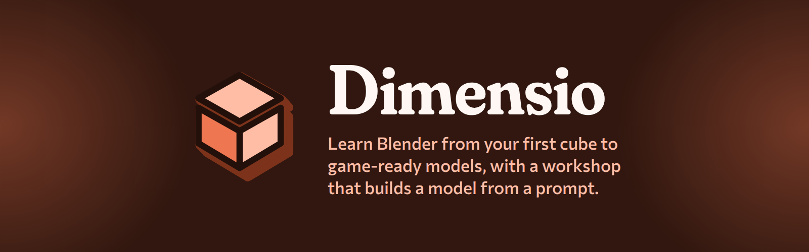

<p align="center"></p>

# Dimensio

Dimensio is a Windows desktop app that teaches Blender. It holds a Blender course with exercises you
do in Blender itself, measures the models you make, and keeps a record of them. Its Workshop builds
a model from a prompt with an agent: Claude Code by default, or Codex. Version 0.4.0, Windows x64.

Dimensio was called Forge3D until October 2026. The Workshop is what Forge3D was.

## Install

Install Dimensio from its card in Instrumenta. Instrumenta downloads the release, checks its hash,
keeps the previous version for rollback, and opens `Dimensio.exe`.

From a source checkout:

```powershell
.\scripts\setup.ps1 -InstallModels
dimensio doctor --json
cd desktop
npm install
npm start
```

`setup.ps1` also takes `-DryRun`, and `-InstallPersonalPlugin` to install the Dimensio plugin for
Codex. Claude Code needs no install step: the Workshop hands it the plugin each run.

## What you need

- Blender 5.2 or later. The course is written for Blender 5.2 LTS, and Dimensio uses Blender to
  measure your models and build exercise scenes.
- For the Workshop, Claude Code installed and signed in, or Codex. Making a splat from words alone
  needs Codex, because Claude Code cannot make the reference image; with Claude Code, attach one.
- Python 3.11 or later and `uv` for the command-line tool, and Node.js 22 or later for the Godot MCP
  server.
- Godot 4.6, if you want to review assets in a game engine. It is optional.
- For TripoSplat, WSL2 Ubuntu with CUDA and an NVIDIA GPU with about 8 GB of video memory.

`dimensio doctor` reports what is missing.

## The course

The course follows a learner from installing Blender to a rigged, animated character in Godot, in 16
parts. Most parts end with a low-poly game asset built with that part's skills. Each lesson has its
steps, diagrams, the teachers' videos and pages it draws on, and an exercise.

The window has these places:

- Home: where you left off, a review or warm-up, and a free prompt to model.
- Course: every part and lesson, with "I already know this" on each lesson.
- Practice: drills, warm-ups, timed exercises, copies of example models, fixes and projects.
- Library: the teachers' videos and pages, and the example models.
- Models: every `.blend` you added, with its renders and measurements, first and latest attempts
  side by side.
- Workshop: projects where an agent builds a model from a prompt.
- Settings and Credits, from the header. Settings holds the Blender path and links to the
  Workshop's agent setup.

An exercise can open a starter scene in Blender. When you have ticked your own checks, Dimensio
measures your model in Blender (triangles, n-gons, non-manifold edges, applied scale, dimensions and
more) and shows the facts and renders, never a score.

The course content lives in `content/` as Markdown and YAML a person can read.
`docs/course/PLAN.md` is the plan the course is built to, and `docs/course/WRITING.md` sets how
every word in it is written.

## The Workshop

The Workshop opens on its start screen: New project, Open project, your recent projects, and any
untitled work a crash left behind. The File menu has New (`Ctrl+N`), Open (`Ctrl+O`), the
recent list, Save (`Ctrl+S`), Save as (`Ctrl+Shift+S`), Show project folder and Close project. The
window title carries the project name, with `●` while it has unsaved changes. Tick "Reopen the last
project when Dimensio starts" to skip the start screen. A `.dimensio` path on the command line opens
that project.

Inside a project you describe a model in the prompt bar, attach pictures or models, and press Run.
The viewport shows the result, with orbit, pan, framing, shading, capture and fullscreen tools on the
left. The run history and a Steps, Files, Checks and Logs inspector are on the right, and a Plan,
Build, Check and Output dock with the run's files runs along the bottom. The status bar shows
whether the agent and the tools are ready; click it to open the setup card, where you choose the
agent.

One run happens at a time. You can steer it or stop it, and its transcript and steps are written to
disk as it goes. A stopped or interrupted run stays in the list and can be continued.

The agent works only inside the run's folder. Claude Code runs with an allowlist (the `dimensio`
command, the Blender and Godot MCP tools, reading files and writing inside the run folder) and
nothing waits for a person to approve. With Codex, contained local commands and local Blender or
Godot tool calls are approved automatically, and anything else asks. Nothing goes to a cloud
provider.

There are two routes for a model:

| Route | Good for | Output |
| --- | --- | --- |
| Authored Blender | Editable props, buildings, rigs, animation, collision, levels of detail | A `.blend` source and a checked `.glb` |
| TripoSplat | Static props where the picture matters more than editing the mesh | Gaussian `.splat` or `.ply` data with a collision proxy |

A splat is not a polygon mesh. Its hidden sides are guessed from one picture. A good source picture
has one whole subject, a little margin, soft light and nothing in front of it.

Each file in a run can be revealed, opened, opened in Blender, reviewed in Godot, copied as a path,
or exported to another format through Blender. Pictures, image sequences, GLB and glTF models and
splats preview in the viewport. Validation reports, text and logs show in the inspector.

## Projects, runs and files

A Workshop project is a folder with one project file and its runs:

```text
%USERPROFILE%\Documents\Dimensio\Projects\Bottle\   (the default place; any folder works)
  Bottle.dimensio                                  the project file: id, run settings, last selection
  runs\<timestamp>-<slug>-<id>\                    one folder per run
```

Runs are written as they happen, so Save only writes the project's run settings and where you left
off. A new project is untitled, and its runs wait in `%LOCALAPPDATA%\Instrumenta\Dimensio\untitled`
until the first Save moves them. Discarding an untitled project sends that folder to the Recycle
Bin. Save as copies a saved project, runs and all.

`run.json` in each run records the prompt, route, settings, steps, files, validation, times, the
transcript and the agent's session. Dimensio never overwrites a file a run made: each version gets a
new folder.

The course keeps its starter scenes and copies of example models in `Documents\Dimensio\Course`.
Settings, logs and caches live in `%LOCALAPPDATA%\Instrumenta\Dimensio` and `%APPDATA%\Dimensio`.

### Coming from Forge3D

The first time Dimensio starts, it copies Forge3D's agent choice and recent projects from
`%LOCALAPPDATA%\Instrumenta\Forge3D\config`, and the course's Blender path from `%APPDATA%\Forge3D`.
Forge3D's run library, `Documents\Forge3D\runs`, opens as a project called Earlier runs.
`.forge3d` projects open as they are and stay `.forge3d` when you save them; Save as makes a
`.dimensio` copy. `FORGE3D_*` environment variables still work when the `DIMENSIO_*` ones are not
set, and models Forge3D installed in WSL are used where they are. Nothing of Forge3D's is moved or
deleted.

## Command line

The app is the usual way in. The `dimensio` command is for checks and repeatable jobs, and it is
what the Workshop's agent runs:

```powershell
dimensio doctor
dimensio capabilities --json
dimensio models list
dimensio models status
dimensio process --help
dimensio rig --help
dimensio animate --help
dimensio retarget --help
dimensio humanoid-retarget --help
dimensio validate --help
```

A local TripoSplat run:

```powershell
dimensio models run triposplat C:\path\to\reference.png `
  --output-dir C:\path\to\output\prop-splat-v001 `
  --gaussians 262144
```

To review a scene with an agent, start Blender with its MCP bridge:

```powershell
.\scripts\start-blender-mcp.ps1
.\scripts\start-blender-mcp.ps1 -BlendFile C:\path\to\asset-v001.blend
```

The command line also has a Tripo cloud option (`dimensio models cloud-run`). It uploads nothing
without `--approve-upload` for that job. The app never uses it.

## Repository map

```text
blender/       Blender tasks: measuring, starter scenes, asset builders
content/       the course: lessons, practice, resources, example models
desktop/       the Electron app: the course app, the Workshop, tests and the Windows package
docs/          the course plan, architecture, schema, brand and release notes
godot/         GLB and Gaussian review project
plugins/       the Dimensio plugin and skill for Claude Code and Codex
scripts/       setup, packaging, launchers and WSL workers
src/dimensio/  the command-line tool
tests/         Python tests
```

Further reading:

- [The course plan](docs/course/PLAN.md) and [how it is written](docs/course/WRITING.md)
- [Desktop process, security, approvals and preview routing](docs/desktop-architecture.md)
- [Capability report](docs/capabilities.md)
- [Run schema and crash recovery](docs/run-schema-v2.md)
- [Humanoid retarget workflow](docs/humanoid-retarget.md)
- [Windows packaging and troubleshooting](docs/releasing.md)
- [Brand identity](docs/brand-identity.md) and [brand v2 alignment](docs/brand/README.md)

## Checking a change

```powershell
uv run --with pytest pytest -q
npm --prefix desktop test
npm --prefix desktop run lint:copy
npm --prefix desktop run build
.\blender\tests\smoke.ps1
```

The Blender and Godot checks need those applications installed.

## Licence

Dimensio is MIT licensed. Bundled integrations keep their own notices, listed in
[`THIRD_PARTY_NOTICES.md`](THIRD_PARTY_NOTICES.md). Other providers' licences and limits are in
`dimensio models info <name>`.

---

<sub>Part of [Instrumenta](https://github.com/George-Nizor/Instrumenta), made by [Bonehead Labs](https://boneheadlabs.org). Brand v2: ember cube, interface type Fraunces, Commissioner and Spline Sans Mono (SIL OFL 1.1, vendored in `desktop/src/renderer/brand/fonts` with its licences). Licence: MIT.</sub>
